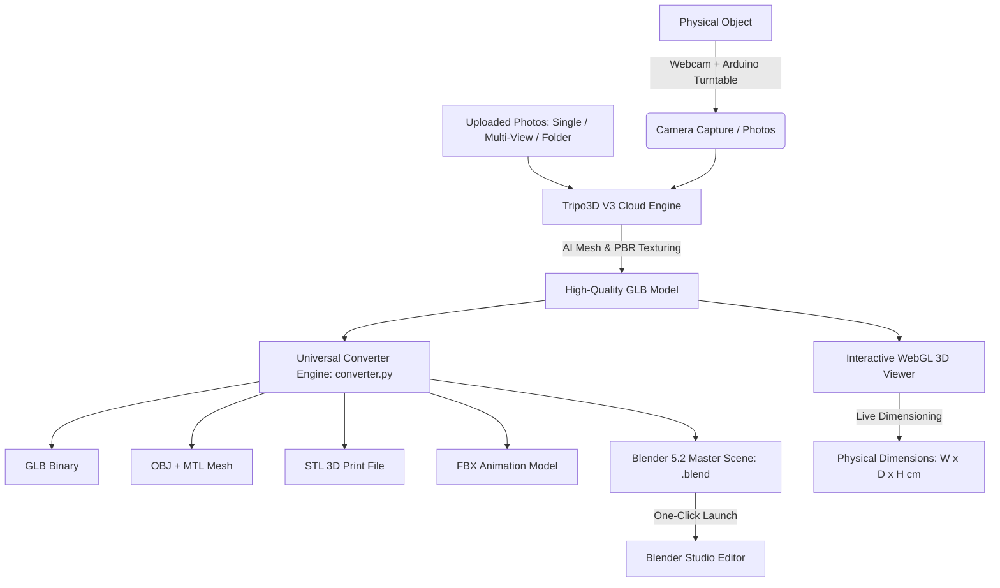

# 3D Scanner & AI Object Reconstruction Studio

[](https://www.python.org/)
[](https://riverbankcomputing.com/software/pyqt/)
[](https://threejs.org/)
[](https://www.blender.org/)
[](https://platform.tripo3d.ai/)

An advanced, end-to-end **3D Scanning, Photogrammetry, and AI 3D Reconstruction Studio**. Seamlessly reconstructs **any physical object or uploaded photos** into high-fidelity 3D assets, automatically exporting them into all industry-standard formats: **GLB, OBJ, STL (3D Printing), FBX (Game/Animation), and Native Blender `.blend` Master Scenes** with automated 3-point studio lighting and hero camera setups.

---

## 🌟 Key Highlights

- **Universal 3D Reconstruction**: Works with **any photos** (single photo, 4-angle orthographic captures, or photo folders). No code changes required for new objects.
- **Automated Multi-Format Export Engine**: Automatically produces:
  - 🌐 **GLB** (`.glb`) — Web-optimized PBR glTF binary format.
  - 🎨 **OBJ** (`.obj` + `.mtl`) — Universal 3D geometry with mapped texture materials.
  - 🖨️ **STL** (`.stl`) — Watertight mesh ready for 3D slicing and 3D printing.
  - 🎮 **FBX** (`.fbx`) — Blender & game-engine optimized asset for Unity/Unreal/Godot.
  - 🎬 **BLEND** (`.blend`) — Complete native Blender 5.2 master workspace with professional 3-point studio lighting, infinite shadow floor plane, hero camera, and packed textures.
- **Interactive 3D WebGL / Three.js Viewer**:
  - Embedded desktop viewport and one-click browser viewer.
  - Smooth OrbitControls, studio lighting, and ground grid.
  - **Dynamic Dimension Calculation**: Real physical bounding dimensions computed live from geometry (`Width × Depth × Height in cm`).
  - **Interactive 3D Dimension Markers**: Visual callouts for top height, width span, depth span, and center anchor with toggle support.
- **Hardware Turntable Automation**:
  - Automated turntable rotation and synchronized webcam capture via Arduino serial communication (`COM` port, 9600 baud).
  - Manual step-by-step multi-angle capture mode with live viewport.
- **Dual Interface**:
  - Sleek **PyQt6 Desktop GUI Application** (`scanner_v3.py`).
  - Headless **Command-Line Pipeline** (`pipeline.py`) for automated or batch processing.

---

## 🔄 System Architecture



---

## 📁 Repository Structure

```text
3D-Scanner-Project/
├── scanner_v3.py             # Main PyQt6 Desktop GUI Application
├── pipeline.py               # Universal Command-Line Pipeline (CLI)
├── converter.py              # Generic Multi-Format Export Engine (GLB/OBJ/STL/FBX/BLEND)
├── setup_blender_scene.py    # Headless Blender 5.2 studio scene generator
├── config.json               # Application configuration (API keys, ports, paths)
├── config.example.json       # Template configuration file
├── requirements.txt          # Python dependencies
├── three.min.js              # Three.js WebGL rendering library
├── OrbitControls.js          # Interactive camera orbit controls
├── GLTFLoader.js             # Three.js glTF/GLB loader
├── scanned_object.glb        # Sample scanned 3D model
├── arduino_button/           # Arduino turntable stepper firmware (.ino)
├── exports/                  # Automated export directory (GLB, OBJ, STL, FBX, .blend)
└── scan/                     # Working directory for captured turntable frames
```

---

## 🛠️ Installation & Setup

### 1. Prerequisites
- **Python**: Version `3.10` or higher (compatible with Python 3.11, 3.12, 3.13, 3.14).
- **Blender**: [Blender 5.2 LTS](https://www.blender.org/) (optional, automatically detected for `.blend` and local FBX export).
- **Tripo3D API Key**: Get a free API key at [platform.tripo3d.ai](https://platform.tripo3d.ai/).

### 2. Clone the Repository
```bash
git clone https://github.com/bhatticoder/3D-Scanner-Project.git
cd 3D-Scanner-Project
```

### 3. Install Python Dependencies
```bash
python -m pip install --upgrade pip
pip install -r requirements.txt
```

### 4. Configure `config.json`
Open [config.json](file:///d:/Projects/app/config.json) and set your Tripo API key and hardware settings:
```json
{
    "tripo_api_key": "your_tripo_api_key_here",
    "arduino_port": "COM4",
    "arduino_baud": 9600,
    "output_path": "d:/Projects/app/scanned_object.glb",
    "export_dir": "d:/Projects/app/exports",
    "num_images": 4,
    "rotation_step": 10,
    "camera_index": 1
}
```

---

## 🚀 How to Use

### Method 1: Desktop GUI Application

Run the graphical application:
```bash
python scanner_v3.py
```

#### In the GUI:
1. **AI 3D Reconstruction from Photos**:
   - **Single Photo → 3D**: Click `📸 Single Photo → 3D` to pick any photo.
   - **Multiple Photos (Multiview)**: Click `🖼️ Multiple Photos` to select 2 to 4 perspective angles (Front, Right, Back, Left).
   - **Folder of Photos**: Click `📁 Folder of Photos → 3D` to reconstruct from a directory of photos.
2. **Hardware Turntable Scanning**:
   - Switch mode to **Auto Turntable** or **Manual Scan**.
   - Click `Execute Hardware Loop` to rotate the turntable and capture frames.
   - The app automatically uploads captured views, compiles the 3D model, and downloads the result.
3. **Automated Multi-Format Exports**:
   - Upon completion, the system automatically exports `.glb`, `.obj`, `.stl`, `.fbx`, and `.blend`.
   - Export buttons allow direct manual export to `FBX`, `OBJ`, `STL`, `GLB`, and `BLEND`.
   - Click **`🚀 Open in Blender 5.2`** to immediately open the generated `.blend` workspace in Blender!
4. **Interactive 3D Inspection**:
   - Click **`🌐 View Scanned 3D Model`** to inspect the object in the interactive viewer.
   - Live bounding box measurements (`Width × Depth × Height in cm`) appear in the header.
   - Click `🏷 Labels: ON/OFF` to toggle 3D dimension markers.

---

### Method 2: Command-Line Pipeline (`pipeline.py`)

Run headless reconstructions and conversions directly from your terminal:

#### 1. Reconstruct from a Single Photo
```bash
python pipeline.py --image "civis_images/civis_front_view.jpg" --name "my_object"
```

#### 2. Reconstruct from Multiple Perspective Photos (Multiview)
```bash
python pipeline.py --images front.jpg right.jpg back.jpg left.jpg --name "scanned_chair"
```

#### 3. Reconstruct from a Folder of Photos
```bash
python pipeline.py --folder "civis_images" --name "delivery_robot"
```

#### 4. Convert an Existing 3D Model to All Formats (OBJ, STL, FBX, BLEND)
```bash
python pipeline.py --glb "scanned_object.glb" --name "master_model"
```

#### 5. Open in Blender Immediately After Generation
```bash
python pipeline.py --glb "scanned_object.glb" --name "hero_asset" --blender
```

#### CLI Options Reference
| Flag | Description |
|---|---|
| `--image, -i` | Path to a single photo for image-to-model 3D reconstruction |
| `--images` | 2 to 4 perspective image paths for multiview reconstruction |
| `--folder, -f` | Directory path containing photos to reconstruct |
| `--glb, -g` | Convert an existing GLB file to OBJ, STL, FBX, and BLEND |
| `--task, -t` | Download and convert an existing Tripo cloud task ID |
| `--name, -n` | Custom base name for exported files |
| `--output-dir, -o` | Custom export directory (defaults to `exports/`) |
| `--api-key, -k` | Tripo API key (overrides `config.json`) |
| `--blender` | Automatically opens the generated `.blend` in Blender |

---

### Method 3: Headless Blender Studio Scene Builder

You can run Blender headlessly to generate studio lighting setups for any 3D model:
```bash
blender.exe -b -P setup_blender_scene.py -- --input "model.glb" --output "exports/model.blend" --title "Object_Name"
```

The script automatically sets up:
- **01_Model Collection**: Imported geometry centered with base grounded at Z=0.
- **02_Studio_Lighting Collection**:
  - **Key Light**: Warm Area light (400W) tracking object center.
  - **Fill Light**: Cool Area light (200W) tracking object center.
  - **Rim / Accent Light**: High-intensity silhouette accent light (500W).
  - **Studio Floor Plane**: Dark matte shadow-catcher ground plane.
- **03_Cameras Collection**: 50mm Hero Camera dynamically positioned to fit the bounding box.
- **Texture Packing**: Automatically packs all textures into the `.blend` file.

---

### Method 4: Arduino Turntable Hardware Loop

To use an automated motorized turntable:
1. Connect an Arduino with a stepper motor driver (A4988 / ULN2003).
2. Open [arduino_button.ino](file:///d:/Projects/app/arduino_button/arduino_button/arduino_button.ino) in Arduino IDE.
3. Flash the firmware to your Arduino board.
4. Set `"arduino_port"` in `config.json` (e.g. `COM4`).
5. Run `python scanner_v3.py` in **Auto Turntable** mode. The computer triggers rotation (`R\n`) step-by-step and automatically captures synchronized frames.

---

## 📦 Supported Export Formats

| Format | Extension | Primary Use Case |
|---|---|---|
| **glTF Binary** | `.glb` | Real-time web viewers, AR/VR, Three.js, lightweight PBR asset |
| **Wavefront** | `.obj` + `.mtl` | Universal interchange format, CAD, legacy 3D editors |
| **Stereolithography** | `.stl` | 3D printing slicers (Cura, PrusaSlicer, Bambu Studio) |
| **Autodesk FBX** | `.fbx` | Game engines (Unreal Engine 5, Unity), rigging, animation |
| **Blender Project** | `.blend` | Master editable workspace with studio lighting, camera & materials |

---

## ⚙️ Configuration Reference (`config.json`)

```json
{
    "tripo_api_key": "tsk_...",              // Your Tripo3D API key
    "arduino_port": "COM4",                  // Arduino serial port (e.g., COM3, COM4, /dev/ttyUSB0)
    "arduino_baud": 9600,                    // Serial baud rate
    "output_path": "d:/Projects/app/scanned_object.glb", // Primary active model path
    "export_dir": "d:/Projects/app/exports", // Destination directory for all exported assets
    "num_images": 4,                         // Number of shots for manual capture
    "rotation_step": 10,                     // Degrees per rotation step for turntable
    "camera_index": 1,                       // Camera index (0 = laptop webcam, 1 = external webcam)
    "students": [                            // Academic attribution (optional)
        { "name": "Member 1", "roll": "23f-1111" },
        { "name": "Member 2", "roll": "22f-1111" }
    ]
}
```

---

## 🤝 Contributing

Contributions, issues, and feature requests are welcome!
Feel free to open an issue or submit a pull request on [GitHub](https://github.com/bhatticoder/3D-Scanner-Project).

---

## 📄 License

This project is licensed under the MIT License.
